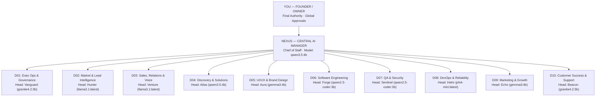

# CODE WIBES TECHNOLOGIES — Company Org Chart

**Hierarchy Model:** Human Founder ➔ Central AI Manager (NEXUS) ➔ 10 Department Heads ➔ 90 Specialist AI Employees (100 Departmental Profiles + NEXUS).

---

## Departmental Summary Table

| Code | Department Name | Department Head | Head Model | Specialist Count |
|---|---|---|---|---|
| **D01** | Executive Operations & Governance | Vanguard | `granite4.2:3b` | 9 Specialists |
| **D02** | Market Research & Lead Intelligence | Hunter | `llama3.1:latest` | 9 Specialists |
| **D03** | Sales, Customer Relations & Voice | Venture | `llama3.1:latest` | 9 Specialists |
| **D04** | Customer Discovery & Solution Architecture | Atlas | `qwen3.5:4b` | 9 Specialists |
| **D05** | UI/UX & Brand Design | Aura | `gemma3:4b` | 9 Specialists |
| **D06** | Software Engineering | Forge | `qwen2.5-coder:3b` | 9 Specialists |
| **D07** | Quality Assurance & Security | Sentinel | `qwen2.5-coder:3b` | 9 Specialists |
| **D08** | DevOps, Deployment & Reliability | Helm | `phi4-mini:latest` | 9 Specialists |
| **D09** | Marketing & Growth | Echo | `gemma3:4b` | 9 Specialists |
| **D10** | Customer Success & Support | Beacon | `granite4.2:3b` | 9 Specialists |

**Total:** 10 Departments, 10 Department Heads, 90 Specialist Employees = **100 Departmental AI Profiles** + **1 Central Coordinator (NEXUS)** = **101 Profiles**.
