# CODE WIBES TECHNOLOGIES — Database Schema Architecture

**Database Engine:** PostgreSQL 16+ / 19  
**ORM:** SQLAlchemy 2.0 (Async) + asyncpg  
**Migration Tool:** Alembic  
**Current Head Migration:** `b3048319aa4f`

---

## 1. Entity-Relationship Overview

```mermaid
erDiagram
    users ||--o{ projects : manages
    departments ||--o{ agents : contains
    agents ||--o{ tasks : assigned
    projects ||--o{ tasks : contains
    projects ||--o{ change_requests : receives
    tasks ||--o{ task_checkpoints : records
    tasks ||--o{ task_dependencies : requires
    leads ||--o{ voice_call_records : targets
    leads ||--o{ customer_requirement_briefs : generates
    customer_requirement_briefs ||--o{ proposal_drafts : compiles
    proposal_drafts ||--o| approval_requests : submits
```

---

## 2. Table Specifications

### 1. `users`
* `id` (UUID PK), `email` (Unique VARCHAR), `hashed_password`, `full_name`, `role`, `is_active`, `is_superuser`, timestamps.

### 2. `departments`
* `id` (UUID PK), `name` (Unique VARCHAR), `slug` (Unique VARCHAR Index), `description` (TEXT), `is_active` (BOOL), timestamps.
* 10 Canonical Departments (`D01` through `D10`).

### 3. `agents`
* `id` (UUID PK), `name`, `role`, `description`, `department_id` (FK), `status`, `provider`, `model_name`, `capabilities` (JSON), `is_active` (BOOL), timestamps.
* 101 records (10 Department Heads + 90 Specialists + NEXUS Central Manager).

### 4. `model_registry`
* `id` (UUID PK), `name` (Unique Index), `digest`, `size_bytes`, `parameter_size`, `quantization`, `advertised_context`, `runtime_context` (Default 8192), `supports_tools`, `supports_vision`, `supports_thinking`, `supports_json`, `task_categories` (JSON), `latency_ms`, `tokens_per_sec`, `benchmark_score`, `status`, `is_enabled`, timestamps.

### 5. `company_memories`
* `id` (UUID PK), `tier` (Index VARCHAR: constitution, founder_preference, department, agent, project, task, customer), `namespace` (Index VARCHAR), `key` (Index VARCHAR), `content` (TEXT), `metadata_json` (JSON), `provenance`, `retention_policy`, timestamps.

### 6. `task_checkpoints`
* `id` (UUID PK), `task_id` (FK Index), `run_number` (INT), `token_count_estimate` (INT), `trigger_reason`, `goal`, `completed_work`, `key_decisions` (JSON), `verified_facts` (JSON), `open_questions` (JSON), `next_exact_actions` (JSON), `file_paths` (JSON), `state_payload` (JSON), timestamps.

### 7. `approval_requests`
* `id` (UUID PK), `task_id` (FK Index), `agent_id` (FK Index), `action_type` (Index: outbound_call, send_proposal, production_deploy, etc.), `title`, `description`, `preview_payload` (JSON), `risk_level` (LOW, MEDIUM, HIGH, CRITICAL), `status` (Index: pending, approved, rejected, expired), `founder_feedback`, `decided_at`, timestamps.

### 8. `task_dependencies`
* `id` (UUID PK), `task_id` (FK Index), `depends_on_task_id` (FK Index), timestamps.

### 9. `leads`
* `id` (UUID PK), `company_name`, `contact_name`, `contact_email`, `phone`, `website`, `has_website`, `city`, `district`, `state`, `industry`, `status`, `place_id` (Unique Index for Places deduplication), `rating`, `review_count`, `google_attribution_required`, `consent_status`, `qualification_score`, `estimated_value`, `source`, `notes`, `provenance_metadata` (JSON), timestamps.

### 10. `voice_call_records`
* `id` (UUID PK), `lead_id` (FK Index), `phone_number_masked`, `is_test_call`, `provider`, `conversation_id`, `call_duration_seconds`, `dlt_template_id`, `consent_verified`, `opt_out_detected`, `status`, `summary`, `transcript_redacted`, `call_metadata` (JSON), timestamps.

### 11. `customer_requirement_briefs`
* `id` (UUID PK), `lead_id` (FK Index), `client_name`, `business_goals`, `target_audience`, `required_pages` (JSON), `required_features` (JSON), `tech_stack_preference`, `brand_guidelines` (JSON), `client_budget_range`, `target_timeline_weeks`, `version`, timestamps.

### 12. `proposal_drafts`
* `id` (UUID PK), `brief_id` (FK Index), `title`, `scope_summary`, `milestones` (JSON), `acceptance_criteria` (JSON), `estimated_hours`, `total_cost_inr`, `pricing_breakdown` (JSON), `status` (draft, awaiting_approval, approved, sent_to_client), `approval_request_id` (FK), timestamps.

### 13. `change_requests`
* `id` (UUID PK), `project_id` (FK Index), `title`, `description`, `is_in_scope` (BOOL), `estimated_hours`, `priority`, `status` (Index: submitted, triaged, in_progress, verified_qa, closed), `resolution_notes`, timestamps.

### 14. `company_settings`
* `id` (UUID PK), `emergency_pause_all_agents`, `disable_external_actions`, `allow_calling_test_mode`, `allow_production_calling`, `founder_verified_phone`, `max_concurrent_models`, `daily_call_limit`, `monthly_budget_cap_usd`, timestamps.

### 15. `activity_logs`
* `id` (UUID PK), `actor_type`, `actor_id`, `action`, `resource_type`, `resource_id`, `details` (JSON with SHA-256 tamper hash and policy decisions), timestamps.
