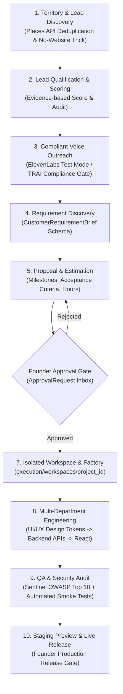

# CODE WIBES TECHNOLOGIES — End-to-End Delivery Workflow

**Brand:** CODE WIBES TECHNOLOGIES  
**Tagline:** *Turning Ideas Into Digital Solutions.*  
**Delivery Model:** Fully traceable, durable pipeline from Customer Brief to QA, Staging, and Production.

---

## 1. The 10-Stage Delivery Workflow

---

## 2. Milestone and Financial Breakdown

Every generated proposal includes transparent milestones:
* **M1 (25%): Discovery & UI/UX Wireframes** — Sitemap, responsive design tokens, and user flow.
* **M2 (45%): Full-Stack Software Engineering** — FastAPI endpoints, PostgreSQL queries, and React frontend.
* **M3 (15%): QA, Accessibility & Security Audit** — Zero OWASP Top 10 defects, responsive verification.
* **M4 (15%): Staging Review & Production Deployment** — Client staging link and production release.

---

## 3. Isolated Client Workspace Isolation

Every project is allocated an isolated directory:
`execution/workspaces/<project_id>/`
- `manifest.json`: Project metadata, tech stack, and git feature branch.
- `src/`: Client source code.
- `public/`: Assets and verified staging `index.html`.
- `tests/`: Automated contract and unit tests.
